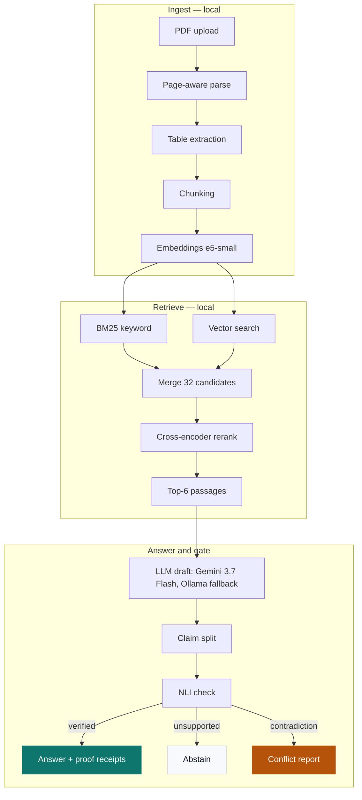

# Deck Instructions — VerifiDoc AI (7 Slides)

A build spec for a **minimal 7-slide presentation** of VerifiDoc AI / ProofLens
(Hack-A-Sol 5.0 — AIML Track, Problem Statement 02, Option B).
Hand this file to a slide tool or designer as-is; it contains the design system,
slide-by-slide copy, and the flow diagram to draw.

---

## 1. Global spec

| Item | Value |
|---|---|
| Slides | Exactly 7, numbered 1–7 (slide 1 is the title) |
| Aspect ratio | 16:9 (1920 × 1080 px) |
| Output | `.pptx` (editable shapes and text, no flattened images) |
| Slide margins | 96 px left/right, 72 px top/bottom |
| Type pairing | Headings **Inter SemiBold**, body **Inter Regular** (fallback: Segoe UI / Calibri) |
| Slide numbers | Bottom-right, 10 pt, muted slate |
| Footer | Bottom-left, 9 pt: `VerifiDoc AI · Evidence First. Every Claim Verified.` |

### Colour palette (use only these)

| Role | Hex | Use |
|---|---|---|
| Ink | `#101828` | Headings, primary text |
| Slate | `#667085` | Body text, captions, labels |
| Hairline | `#D0D5DD` | 1 px dividers, diagram connectors |
| Surface | `#F7F9FC` | Card and diagram box fills |
| Paper | `#FFFFFF` | Slide background |
| Accent — Verified | `#0F766E` (teal) | The one accent colour: active step, key number, "verified" state |
| Accent — Review | `#B45309` (amber) | Only for contradiction / abstain states, max 2 uses in the deck |

**Rules**

- Background is always `#FFFFFF`. No gradients, no drop shadows, no stock photos, no icons unless listed.
- **One accent colour per slide.** Teal by default; amber appears only on slides 5 and 6.
- Maximum **25 words of body text per slide**. Headline ≤ 8 words.
- Left-align everything except the title slide. Never centre a bullet list.
- No paragraphs, no bullet walls, no more than 4 items per slide.
- Generous whitespace: at least 40% of every slide stays empty.
- Data and claims must match the project README; do not invent numbers.

---

## 2. Slide-by-slide

### Slide 1 — Title

- Background: `#FFFFFF`, a 6 px `#0F766E` bar down the left edge (full height, 0–24 px from edge).
- Eyebrow (12 pt, letter-spaced, teal): `HACK-A-SOL 5.0 · AIML TRACK · PS-02 OPTION B`
- Title (54 pt, Ink): **VerifiDoc AI**
- Subtitle (24 pt, Slate): *Zero-guessing document intelligence*
- One line under it (18 pt, Ink): **Evidence first. Generation second. Verification always.**
- Bottom area: three small labels in a row, 12 pt Slate, separated by hairline dividers:
  `React + FastAPI` · `Hybrid LLM — Gemini 3.7 Flash / Qwen 3.5` · `Local retrieval + NLI verification`

### Slide 2 — Problem

- Headline: **Answers you cannot check**
- Three short lines, 20 pt Ink, each with a 4 px teal left rule:
  1. `LLMs answer fluently — and invent citations.`
  2. `Documents disagree: dates, limits, amendments.`
  3. `Compliance work needs proof, not confidence.`
- Right side: a small quote block on `#F7F9FC`, 16 pt Slate italic:
  *"A confident wrong answer is worse than no answer."*
- No diagram on this slide.

### Slide 3 — The rule we built on

- Headline: **Three gates, in order**
- Horizontal 3-step strip, evenly spaced, boxes 380 × 220, fill `#F7F9FC`, 1 px `#D0D5DD` border, 12 px radius:
  1. **Evidence** — retrieve real passages from the uploaded PDFs
  2. **Generation** — the model drafts only from those passages
  3. **Verification** — an NLI model checks every claim; fail = abstain
- Connectors between boxes: 2 px `#D0D5DD` arrows, arrowheads `#667085`.
- Teal applied only to step 3 (the gate) — its number `03` in teal, box border teal.
- Caption (14 pt Slate, bottom): `Draft first, trust never.`

### Slide 4 — Flow diagram (the core slide)

Headline: **How a question becomes a verified answer**

Draw a single left-to-right pipeline in three bands. Boxes 200 × 92, fill `#F7F9FC`,
border 1 px `#D0D5DD`, radius 10 px, label 13 pt Ink, sub-label 10 pt Slate.
Connectors: 2 px `#667085` arrows. All bands share the same vertical rhythm; align boxes to a 12-column grid.

**Band A — Ingest (top row, 5 boxes)**

`PDF upload` → `Page-aware parse` → `Table extraction` → `Chunking` → `Embeddings (e5-small)`

**Band B — Retrieve (middle row, 4 boxes)**

`BM25 keyword` ↘
                    `Merge candidates (32)` → `Cross-encoder rerank` → `Top-6 passages`
`Vector search` ↗

Show the two retrieval branches converging into one box: two arrows meeting, then a single arrow forward. Label the merge `hybrid`.

**Band C — Answer and gate (bottom row, 5 boxes)**

`LLM draft (Gemini 3.7 Flash → Ollama fallback)` → `Claim split` → `NLI check` → three outcomes:

- `Verified` — teal fill `#0F766E`, white text, arrow to `Answer + proof receipts`
- `Neutral / unsupported` — `#F7F9FC`, arrow to `Abstain`
- `Contradiction` — amber `#B45309`, white text, arrow to `Conflict report`

**Layout note:** bands flow down, not across — Band A along the top, Band B in the middle,
Band C at the bottom, connected by two down-arrows at the left and one at the right so the
diagram reads as one continuous path. Keep every box the same height so the eye follows a line.

Caption (14 pt Slate): `Retrieval, reranking and verification run locally.`

### Slide 5 — What makes it different

- Headline: **Proof, not prose**
- 2 × 2 grid of four cards, 520 × 190, `#F7F9FC` fill, no border, 4 px teal left rule:
  1. **Citation-checked claims** — every sentence maps to a page, chunk and quotation
  2. **Contradiction detection** — clashing numbers and dates are surfaced, both quotes kept
  3. **Amendment chains** — as-of-date resolution of superseded documents *(amber rule — this one is MVP-scoped)*
  4. **Honest abstention** — no evidence means no answer, never a guess
- Under each card, 11 pt Slate: the scope word — `implemented`, `MVP`, `MVP`, `implemented`.
- Footnote (11 pt Slate): `Heuristic where marked MVP — evidence-oriented assistance, not legal advice.`

### Slide 6 — Proof in the loop

- Headline: **One question, one receipt**
- Left: a narrow vertical flow of 4 tiny steps, connected by hairlines:
  `Question` → `6 passages` → `Draft` → `All claims verified` (the last in teal)
- Right: a mock answer card on `#F7F9FC`, 1 px `#D0D5DD` border, containing:
  - `verified` chip (teal fill, white 10 pt text, 4 px radius)
  - two grey text bars representing the answer (10 px tall, `#D0D5DD`, 90% and 70% width)
  - three source lines at 11 pt Slate: `policy_2024.pdf · p.12`, `amendment_b.pdf · p.3`, `faq.pdf · p.7`
- Under the card, one amber pill: `1 contradiction found — see conflict report`.
- Caption: `The user sees the evidence, not just the confidence.`

### Slide 7 — Close

- Headline: **Evidence first. Every claim verified.**
- Three short lines, 18 pt Ink:
  - `Answers: grounded, cited, or refused`
  - `Stack: React · FastAPI · e5-small · NLI-DeBERTa · hybrid LLM`
  - `Model weights stay local; only retrieval evidence is sent to the hosted model`
- Bottom: a thin teal rule, then `github.com/<org>/ProofLens` (Slate, 14 pt) and three names, 12 pt.
- No call-to-action buttons, no thank-you slide, no QR code.

---

## 3. Diagram code (paste into a diagram-capable tool)

Colour mapping for the generated shapes: `#0F766E` = verified outcome,
`#B45309` = contradiction outcome, `#F7F9FC` + `#D0D5DD` = every other box.

---

## 4. Speaker notes (one line each, ≤ 20 words)

1. "We built a document AI that refuses to guess."
2. "Fluency is not accuracy — and compliance teams cannot audit fluency."
3. "Evidence, then generation, then an independent check."
4. "Every answer walks this path; nothing skips the gate."
5. "Four capabilities, each with its scope stated honestly."
6. "A verified answer ships with its receipts — and its conflicts."
7. "Grounded, cited, or refused. No third option."

---

## 5. Acceptance checklist

- [ ] Exactly 7 slides, 16:9, editable shapes.
- [ ] Only the seven listed colours appear anywhere in the deck.
- [ ] Slide 4 reads left-to-right, top-to-bottom as one uninterrupted path.
- [ ] No slide exceeds 25 body words; no bullet list longer than 4 items.
- [ ] Teal is the only accent on slides 1–4, 6 (chips/steps) and 7; amber appears only for
      contradiction and MVP scope.
- [ ] No stock imagery, gradients, shadows, emoji, or clip art.
- [ ] Every technical claim matches `README.md` (model names, hybrid provider order,
      local verification, MVP scope caveats).
